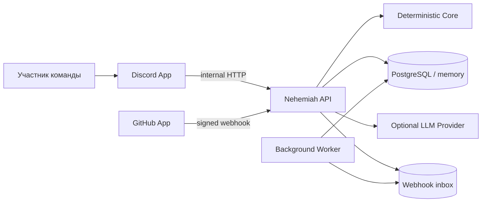
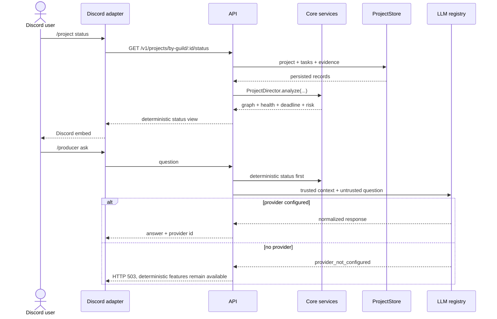
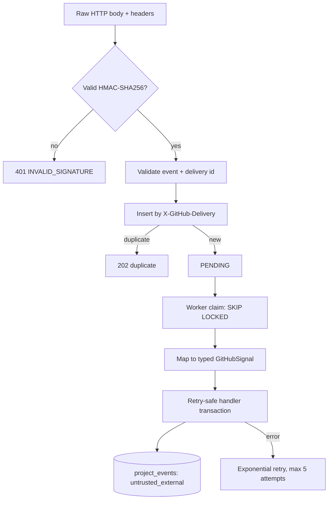

# Архитектура v1.0.0

> v1 включает application service `phase2-service`, migrations through
> `003_release_hardening.sql`, persistent Mission Control/settings, vision revisions, blockers,
> assignments, risk history, GitHub activity/task links и notification outbox. Provider-neutral
> правило сохраняется: AI предлагает structured mutations, core валидирует, store коммитит только
> после authorization.

Nehemiah: модульный монолит с тремя process entry points. Архитектура отделяет воспроизводимые
проектные решения от внешних интерфейсов и поставщиков.

## Контекст

Discord выступает интерфейсом, а GitHub и LLM как внешние интеграции. Ни одна из них не является частью доменной модели.

## Модули

| Модуль                   | Ответственность                                                                   | Может зависеть от                       |
| ------------------------ | --------------------------------------------------------------------------------- | --------------------------------------- |
| `packages/core`          | Entities, TaskGraph, lifecycle, risk, health, deadline, permissions, memory ports | стандартная библиотека                  |
| `packages/database`      | In-memory/PostgreSQL stores, migrations, webhook inbox                            | github, `pg`                            |
| `packages/github`        | Signature, envelope, event mapping и bounded retry processor                      | стандартная библиотека                  |
| `packages/llm`           | Нейтральный контракт, registry, FakeProvider, vendor adapters                     | `fetch`, provider-neutral DTO           |
| `packages/discord-kit`   | Slash-команды, modals, interaction handler, HTTP client                           | discord.js                              |
| `packages/config`        | Zod-валидация env и composition settings                                          | Zod                                     |
| `packages/observability` | Структурированные логи и redaction                                                | Pino                                    |
| `packages/shared`        | Clock, IDs, Result и технические errors                                           | стандартная библиотека                  |
| `apps/api`               | HTTP composition root и application vertical slice                                | перечисленные packages                  |
| `apps/discord`           | Discord gateway process                                                           | config, discord-kit, observability      |
| `apps/worker`            | Durable GitHub inbox processor                                                    | config, database, github, observability |

Dependency direction направлен внутрь: core не импортирует adapters. Ports в core позволяют
добавлять persistence/event implementations без vendor types в домене.

## Основной вертикальный срез

AI не является fallback для отсутствующей доменной логики: перед `/producer ask` API уже вычисляет
project status детерминированно.

## GitHub event pipeline

В memory-режиме API обрабатывает принятый webhook сразу. Отдельный memory worker имеет собственный
изолированный inbox и поэтому предназначен только для smoke/demo. В PostgreSQL-режиме API пишет в
общую durable таблицу, worker безопасно забирает записи.

## Trust boundaries

### Discord → API

- Discord interaction считается пользовательским вводом.
- Discord adapter использует только `Guilds` intent и application commands.
- API DTO валидируются независимо от Discord client.
- В production каждый `/v1/*` запрос требует `x-nehemiah-internal-token`; comparison constant-time.
- Setup дополнительно требует Manage Server, а task update требует ownership текущего участника.

### GitHub → API

- Подпись проверяется по исходной строке body до `JSON.parse`.
- Неподдерживаемые события игнорируются, а не попадают в произвольный handler.
- Payload маркируется `untrusted_external`; в `project_events` сохраняются нормализованные signals,
  а не trusted instructions.
- Delivery ID обеспечивает дедупликацию независимо от повторной доставки GitHub.

### API → LLM

- Core не знает provider, model, API key или SDK type.
- Registry может быть пустым; AI call завершается нормализованной ошибкой.
- Provider capabilities проверяются до запроса.
- Tool calls, structured output, reasoning state, streaming protocol и provider errors переводятся
  внутри adapter.
- Producer помещает structured project context в system message, а пользовательский вопрос в
  отдельное untrusted user message.

### Runtime → PostgreSQL

- Queries параметризованы.
- Каждая миграция атомарна и записывается в `nehemiah_migrations`.
- Advisory lock не допускает параллельное применение схемы.
- Inbox claim использует row locks и восстанавливает stale processing records.

## Данные

PostgreSQL schema содержит workspaces, projects, team members, milestones, tasks, dependencies,
evidence, decisions, risks, checkpoints, integrations, project events, structured memory, GitHub
installations/repositories и webhook inbox. In-memory store реализует только вертикальный срез и не
переживает restart.

## Runtime topology

Минимальный deterministic demo: один `apps/api` с memory storage и FakeProvider/без AI.

Durable development/production baseline:

- `apps/api`: HTTP и webhook ingestion;
- `apps/worker`: webhook processing;
- `apps/discord`: Discord gateway;
- PostgreSQL 18: единый durable store.

Redis не требуется в v1.0: locking и queue semantics реализованы PostgreSQL inbox. Если
появятся измеренные проблемы с throughput/latency, это решение можно пересмотреть.

## Нефункциональные решения

- Node.js 24, TypeScript strict, ESM и pnpm workspaces.
- Fastify body limit 1 MiB и `trustProxy: false` по умолчанию.
- Structured Pino logging с secret redaction.
- Graceful SIGINT/SIGTERM для всех процессов.
- Детерминированные тесты не используют сеть или live credentials.

Текущие эксплуатационные ограничения перечислены в [roadmap](roadmap.md), а security assumptions в
[SECURITY.md](../SECURITY.md).
