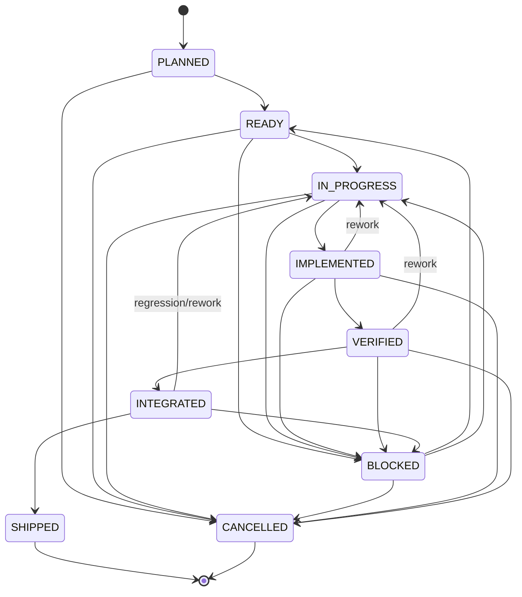

# Доменная модель v1.0

Phase 2 first-class aggregates: `ProjectVision` + `VisionRevision`, `Decision`, `Task` + `TaskDependency` + `TaskEvidence`, `Blocker`, `AssignmentRecord`, `RiskSnapshot`, `ProjectSettings`, `GitHubActivity` и `Milestone`. Approved vision/scope изменяется только через approval + Decision; AI proposal не является mutation authority.

`packages/core`: TypeScript/ESM ядро без Discord, GitHub, PostgreSQL и LLM SDK. Объекты
валидируют инварианты при создании и не делегируют вычислимые решения модели.

## Основные агрегаты и value objects

| Концепт                     | Назначение                                                                    |
| --------------------------- | ----------------------------------------------------------------------------- |
| `Workspace`                 | Граница организации, owner и набор участников                                 |
| `Project` / `ProjectVision` | Цель, описание, success criteria, non-goals, constraints, mode, deadline      |
| `Milestone`                 | Due date, критерии завершения и связанные задачи                              |
| `TeamMember`                | Профиль участника и project membership                                        |
| `Role` / `Skill`            | Права и уровень навыка 1-5                                                    |
| `Availability`              | Timezone, weekly capacity и окна доступности                                  |
| `CommunicationPreferences`  | Стиль, язык, DM/mention и quiet hours                                         |
| `AIToolProfile`             | Инструменты участника; это не runtime LLM configuration                       |
| `Task`                      | Work item, impact, weight, effort, owner, due date и evidence                 |
| `TaskDependency`            | Направленное ребро и требуемый completion status                              |
| `TaskEvidence`              | Commit, PR, review, check, test, build, artifact, deployment или manual proof |
| `Decision`                  | Контекст, outcome, rationale и supersession                                   |
| `Risk`                      | Signal, weight, contribution, severity и human-readable evidence              |
| `ProjectCheckpoint`         | Milestone/freeze/release gate и критерии                                      |
| `Integration`               | GitHub/Discord/CI/issue tracker/custom connection metadata                    |
| `ProjectEvent`              | Типизированное событие с actor/source/correlation                             |
| `ProjectMemory`             | Явно структурированные facts, decisions, constraints и lessons                |

## Task lifecycle

`IMPLEMENTED` означает наличие результата реализации. Это не `VERIFIED`, не `INTEGRATED` и тем
более не `SHIPPED`.

### Guards

- Переход в `READY` или `IN_PROGRESS` требует `TaskGraph` и удовлетворённых зависимостей.
- Для `IN_PROGRESS` нужен owner.
- Для `BLOCKED` нужен непустой reason.
- Timestamp перехода не может предшествовать `task.updatedAt`.
- `IMPLEMENTED` требует evidence вида `COMMIT`, `PULL_REQUEST`, `BUILD` или `ARTIFACT`.
- `VERIFIED` требует `REVIEW`, `CHECK_RUN`, `TEST_RESULT` или `MANUAL_VERIFICATION`.
- `INTEGRATED` требует `BUILD`, `CHECK_RUN` или `DEPLOYMENT`.
- `SHIPPED` требует `DEPLOYMENT` или `ARTIFACT`.
- Evidence принадлежит ровно одной задаче и не дублируется по ID.
- `SHIPPED` и `CANCELLED` терминальны.

HTTP vertical slice автоматически типизирует текст evidence по целевому статусу, но core guard
остаётся обязательным.

## TaskGraph

Ребро направлено от prerequisite к dependant. По умолчанию dependant становится доступным, когда
prerequisite достиг `VERIFIED`; для конкретного ребра можно потребовать `IMPLEMENTED`, `INTEGRATED`
или `SHIPPED`.

`TaskGraph` предоставляет:

- прямые dependencies и dependants;
- запрет self-dependency и cross-project graph;
- обнаружение циклов и rollback добавленного циклического ребра;
- стабильную топологическую сортировку;
- ready-task detection;
- явную и транзитивную blocked-task диагностику;
- raw и impact-weighted estimated effort;
- longest-path critical path по обычной или weighted duration;
- remaining-only расчёт без cancelled/completed work.

Weighted effort задачи:

`estimatedEffortHours × task.weight × impactWeight`

Impact weights: `LOW=0.75`, `MEDIUM=1`, `HIGH=1.75`, `CRITICAL=2.5`.

## Risk Engine

Risk Engine всегда возвращает все девять оценок; неактивный signal имеет contribution 0. Активные
сигналы создают объяснимые `Risk` entries.

| Signal                            | Вес по умолчанию |
| --------------------------------- | ---------------: |
| Critical task without owner       |               15 |
| Overdue critical-path task        |               18 |
| Blocked critical task             |               16 |
| Failing required checks           |               12 |
| Unreviewed high-impact change     |               10 |
| Shrinking deadline buffer         |               12 |
| No integrated build for too long  |                7 |
| Increasing unfinished scope       |                5 |
| Unresolved integration dependency |                5 |

Score ограничен диапазоном 0-100. Severity: `LOW` ниже 20, `MODERATE` от 20, `HIGH` от 40,
`CRITICAL` от 70. Веса можно переопределить при создании движка; invalid/negative weights
отклоняются.

Каждый signal содержит code, title, active flag, weight, contribution, raw value, severity,
affected task IDs и строки evidence. LLM может позже переформулировать объяснение, но не меняет
score.

## Project Health

Закрытые задачи не считаются равнозначными. Каждая dimension вычисляет выполненный impact-weighted
объём, затем общий score объединяет dimensions:

| Dimension         | Вес overall |
| ----------------- | ----------: |
| Implementation    |         35% |
| Verification      |         25% |
| Integration       |         25% |
| Release readiness |         15% |

Например, `IMPLEMENTED` даёт 100% implementation, но только 15% verification, 5% integration и 0%
release readiness. `INTEGRATED` ещё даёт только 50% release readiness; 100% означает `SHIPPED`.
Cancelled work исключается, а задачи с `releaseRequired=false` не входят в release denominator.

## Deadline и project phase

Buffer: `availableCapacityHours - requiredEffortHours`, а не просто оставшееся календарное время.
Статусы: `SAFE`, `TIGHT`, `EXHAUSTED`.

Для `STANDARD`:

- более 30 дней: `PRODUCTION`;
- 14-30 дней: `SCOPE_LOCK`;
- 3-14 дней: `FEATURE_FREEZE`;
- до 3 дней: `SHIP_MODE`.

Для `GAME_JAM` thresholds относительны общей длительности: 50%, 25% и 10% оставшегося времени.
После дедлайна используется `DEADLINE_PASSED`.

## Permissions

Core различает permissions просмотра/управления проектом и командой, создания/назначения/изменения
задач, решений, checkpoints, integrations, risks и producer access. Workspace owner имеет полный
доступ; остальные получают permissions из ролей. `TASK_UPDATE_OWN` действует только для owner
конкретной задачи и внутри project membership.

HTTP v1.0 использует строгую policy: Discord-пользователь может обновить только назначенную
ему задачу. Полный role-based core service подготовлен для следующих application endpoints.

## Structured Project Memory

Core concepts:

`FACT`, `DECISION`, `CONSTRAINT`, `ARCHITECTURE`, `REQUIREMENT`, `TEAM_INFORMATION`, `RISK`,
`LESSON`.

Запись содержит subject/content, tags, source, confidence, author, timestamp, metadata и explicit
supersession. Решение обязано ссылаться на structured `Decision`. Query фильтрует concept, tags,
source, confidence, time и text; superseded entries по умолчанию скрыты.

Persistence/API vocabulary v1.0 использует короткое имя `TEAM` для `TEAM_INFORMATION`. Это
adapter-level представление и не превращает memory в необработанный чат-архив.
